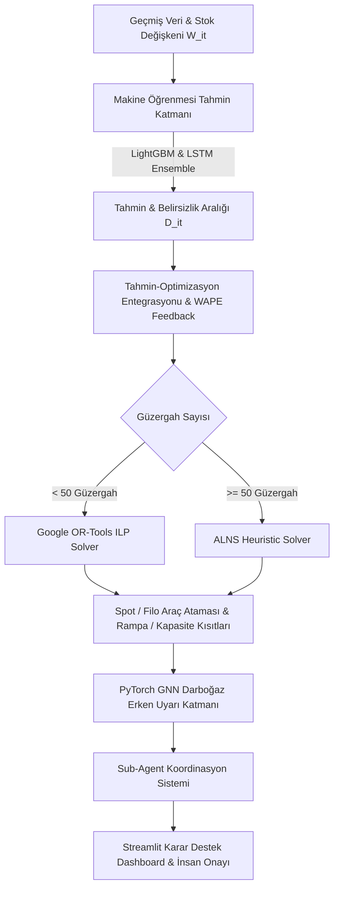

# 🚚 TEKNOFEST 2026 - Lojistik Optimizasyon Sistemi

[](https://www.python.org/)
[](LICENSE)
[](https://pytorch.org/)
[](https://lightgbm.readthedocs.io/)
[](https://developers.google.com/optimization)
[](https://github.com/Umutcagn/logistics-fleet-network-optimization/actions/workflows/tests.yml)

> **Entegre Makine Öğrenmesi (LightGBM + PyTorch LSTM), FSMVRP Rota Optimizasyonu (Google OR-Tools ILP / ALNS), PyTorch GNN Darboğaz Erken Uyarısı ve Sub-Agent Yönetişim Paneli.**

---

## 📌 İçindekiler
- [Proje Hakkında](#-proje-hakkında)
- [Sistem Mimarisi](#-sistem-mimarisi)
- [Matematiksel Formülasyon](#-matematiksel-formülasyon)
- [Özellikler & Teknolojiler](#-özellikler--teknolojiler)
- [Kurulum](#-kurulum)
- [Kullanım](#-kullanım)
- [Testler](#-testler)
- [Akademik Kaynakça](#-akademik-kaynakça)

---

## 📖 Proje Hakkında

Bu proje, Türkiye genelindeki Transfer Merkezleri (TM) ve lojistik ağı için geliştirilmiş **uçtan uca entegre karar destek ve rota optimizasyon sistemidir**. Geleneksel bağımsız modüller yerine, **tahmin çıktısını optimizasyona ve optimizasyon maliyetini tahmin katmanına besleyen** yaşayan bir pipeline mimarisine sahiptir.

---

## 🏗️ Sistem Mimarisi



---

## 📐 Matematiksel Formülasyon

### 1. Amaç Fonksiyonu (Denklem 1.1)
$$\min Z = \sum_{(k,m)} F_m \cdot Y_{mk} + \sum_{(i,j,k)} D_{ij} \cdot C_k \cdot X_{ijk} + \sum_{(i,j,t)} S_{ij} \cdot Z_{spot\_ijt} + \sum_{(i,t)} \beta \cdot W_{it}$$

- $F_m$: $m$ tipi filo aracının günlük sabit maliyeti ($\text{Tır}=4500\text{TL}, \text{Kamyon}=2800\text{TL}, \text{Hafif Kamyon}=1800\text{TL}, \text{Kamyonet}=1100\text{TL}$)
- $D_{ij}$: Güzergah mesafesi (km)
- $C_k$: Km başına yakıt ve bakım maliyeti
- $S_{ij}$: Spot araç toplam kiralama maliyeti
- $\beta$: Birim desi başına Transfer Merkezi bekleme ve elleçleme maliyeti

### 2. Kısıtlar
- **K1 (Talep Karşılama)**: $\sum_m (\text{cap}_m \cdot X_{ijk} \cdot Y_{mk}) + \text{cap}_{spot} \cdot Z_{spot\_it} \ge \hat{D}_{it} \quad \forall(i,j,t)$
- **K2 (Araç Kapasitesi)**: $l_{ij} \le \sum_m \text{cap}_m \cdot X_{ijk} \cdot Y_{mk} \quad \forall(i,j,k)$
- **K3 (Rampa Kısıtı)**: Tır rampası olmayan merkeze otomatik küçük araç ataması ($\sum_k W_{itk} \le R_i$).
- **K4 (Elleçleme Kapasitesi)**: $\text{Giden}(i,t) \le H_i \times \Delta t$.
- **K5 (Doluluk Toleransı)**: $l_{ij} \ge (1-\alpha) \cdot \text{cap}_m \cdot X_{ijk} \cdot Y_{mk}$ ($\alpha_{\text{tır}}=0.10, \alpha_{\text{kamyon}}=0.15, \alpha_{\text{kamyonet}}=0.20$).
- **K6 (Tamsayı Kısıtları)**: $X_{ijk}, Y_{mk} \in \{0,1\}, Z_{spot\_ijt} \in \mathbb{Z}^+$.

---

## 🛠️ Özellikler & Teknolojiler

- **Makine Öğrenmesi (ML)**: LightGBM (kısa vadeli kampanya etkileri) + PyTorch LSTM (30 günlük sliding window) + Stacking MetaLearner (WAPE bazlı dinamik ağırlıklandırma).
- **Rota Optimizasyonu (FSMVRP)**: Google OR-Tools ILP SCIP/CBC Solver + Adaptive Large Neighborhood Search (ALNS) Heuristic.
- **Graf Sinir Ağı (GNN)**: Düz PyTorch ile yazılmış, ortalama-komşu mesaj iletimli Transfer Merkezleri darboğaz erken uyarı modeli (MARLHOSA prensibi). Sentetik ağ senaryolarıyla eğitilmiştir (bkz. [GNN Eğitimi](#-gnn-eğitimi-ve-değerlendirme)).
- **Sub-Agent & Human-in-the-Loop**: 3 uzman alt ajan (Talep, Optimizasyon, GNN) ve kritik kararlarda lojistik sorumlusu onay paneli.
- **Arayüz**: Streamlit etkileşimli kontrol paneli.

### ⚠️ Bilinen Sınırlamalar
- Veriler sentetiktir (`src/data/synthetic_data_generator.py`); sonuçlar gerçek operasyon verisiyle doğrulanmamıştır.
- `ortools` yüklü değilse ILP yerine sezgisel (heuristic) çözücüye, `lightgbm` yüklü değilse scikit-learn `HistGradientBoostingRegressor`'a sessizce geçilir.
- GNN, gerçek darboğaz kayıtlarıyla değil, açık bir kapasite/taşma kuralıyla etiketlenmiş sentetik senaryolarla eğitilmiştir; yani bu kuralı öğrenir, gerçek operasyondan öğrenilmiş bir model değildir.

---

## ⚡ Kurulum

```bash
# Repository'yi klonlayın
git clone https://github.com/Umutcagn/logistics-fleet-network-optimization.git
cd logistics-fleet-network-optimization

# Gerekli paketleri yükleyin
pip install -r requirements.txt
```

---

## 🚀 Kullanım

### 1. Uçtan Uca Pipeline Çalıştırma (CLI)
```bash
python run_pipeline.py
```

### 2. Streamlit Web Dashboard'unu Başlatma
```bash
streamlit run app.py
```
Tarayıcınızda `http://localhost:8501` adresine gidin.

---

## 🧠 GNN Eğitimi ve Değerlendirme

Gerçek etiketli darboğaz verisi olmadığından etiketler açık bir kuraldan üretilir. Bir transfer merkezi, kendi 12 saatlik yük oranı ile aşırı yüklü komşularından taşan yükün toplamı kapasitesine ulaştığında darboğaz sayılır:

$$\text{load}_i + 0.5 \cdot \frac{1}{|N(i)|}\sum_{j \in N(i)} \max(0, \text{load}_j - 1) \ge 1$$

Model; gerçek 10 transfer merkezi üzerinde rastgele yük seviyeleri ve rastgele güzergah grafları içeren 6.000 eğitim, 1.500 doğrulama ve 2.000 test senaryosuyla eğitilir (~7 sn, CPU):

```bash
python -m src.gnn.train_gnn   # ağırlıklar: src/gnn/bottleneck_gnn_weights.pt, metrikler: src/gnn/training_metrics.json
```

Test seti (20.000 düğüm) sonuçları, komşuları görmeyen eşik kuralıyla (`load ≥ 1`) karşılaştırmalı:

| Model | Doğruluk | Kesinlik | Duyarlılık | F1 | Yalnızca komşu taşmasından doğan darboğazları yakalama (977 düğüm) |
|---|---|---|---|---|---|
| Düğüm eşiği (komşusuz) | 0.951 | 1.000 | 0.859 | 0.924 | %0 |
| **GNN** | **0.990** | **0.990** | **0.982** | **0.986** | **%90.3** |

GNN'in kazancı tamamen graf yapısından gelir: yalnızca kendi yüküne bakan bir kural, komşu merkezlerden taşan yükü göremez.

> Not: Pipeline'ın ürettiği mevcut sentetik talepte merkezlerin yük oranı %6–24 arasındadır; talep 3 katına çıksa bile (dashboard stres modu) kapasite aşılmaz ve model alarm üretmez.

---

## 🧪 Testler

Projedeki tüm alt modüller `pytest` ile test edilmiştir:
```bash
python -m pytest tests/
```

---

## 📚 Akademik Kaynakça

1. **Weng, S. et al. (2020)**. *Supply chain sales forecasting based on LightGBM and LSTM combination model*. Industrial Management & Data Systems.
2. **Ling, J. & Wu, W.B. (2025)**. *Comparative Analysis of Global and Local Probabilistic Time Series Forecasting*. arXiv:2509.08214.
3. **Fung, W. et al. (2025)**. *OpComm: A Reinforcement Learning Framework for Adaptive Buffer Control*. arXiv:2512.19738.
4. **Mandi, J. et al. (2024)**. *Decision-Focused Learning: Foundations, State of the Art*. JAIR.
5. **Fachini, R.F. et al. (2025)**. *A stochastic programming approach for the operational fleet composition problem*. ITOR.
6. **Salhi, S. et al. (2013)**. *The Fleet Size and Mix Vehicle Routing Problem with Backhauls*. Transportation Research Part E.
7. **Taherkhani, G. et al. (2025)**. *Exact Solution Method for Multi-Stakeholder Freight Transportation Systems Under Uncertainty*. Transportation Research Part B.
8. **Zhang, M. & Pan, C. (2024)**. *Hierarchical Optimization Scheduling Algorithm Based on Multi-Agent Reinforcement Learning*. IEEE T-ITS.
9. **Zhao, Y. & Jiang, Z. (2026)**. *Hub Location and Linehaul Route Planning with Truck Platooning*. Symmetry.
